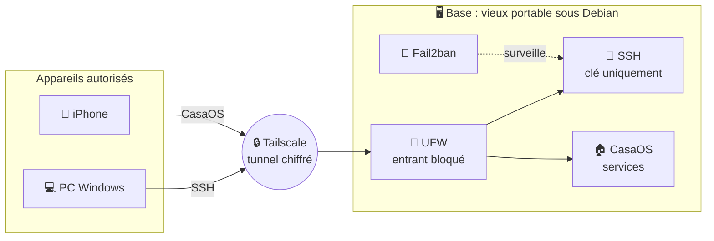

<!--
  README de profil GitHub : thème "service secret", noir & or
  1. Dépôt PUBLIC nommé exactement comme ton pseudo GitHub
  2. Ce fichier à la racine sous le nom README.md
  3. Remplace TON_PSEUDO / TON_PRENOM / liens (Ctrl+H)
  4. Pour le snake : voir le fichier snake.yml (à mettre dans .github/workflows/)
-->

<div align="center">


<a href="https://github.com/johangsmt-boop">
  
</a>

<br/>


</div>

<br/>

## ◼ DOSSIER CONFIDENTIEL

```text
╔═[ SERVICE SECRET · DOSSIER N°001 ]══════════════
║
║  AGENT          Johan
║  FORMATION      BTS SIO · 1re année
║  PROFIL         Développeur junior
║  SPÉCIALITÉS    Développement · Réseau · Cybersécurité
║  LANGAGES       JavaScript · Python
║  BASE           Home lab (Debian · CasaOS · Tailscale)
║  AUTORISATION   Permis de coder ✔
║  STATUT         En recherche de stage
║
╚═════════════════════════════════════════════════
                                   [ CONFIDENTIEL ]
```

---

## ◼ BRIEFING DE MISSION

> **Objectif** : intégrer une équipe en stage pour apprendre, être utile et progresser.
> **Atouts** : curiosité, rigueur, et un home lab que j'ai monté et sécurisé moi-même.
> **Terrain de jeu** : développement, administration systèmes et réseaux, sécurité.

---

## ◼ Q BRANCH · L'ARSENAL

> Chaque badge est cliquable : un clic, et le dossier technique s'ouvre.

**`ARMES DE CODE`**

<p>
  <a href="https://developer.mozilla.org/fr/docs/Web/JavaScript"></a>
  <a href="https://www.python.org/"></a>
  <a href="https://developer.mozilla.org/fr/docs/Web/HTML"></a>
  <a href="https://developer.mozilla.org/fr/docs/Web/CSS"></a>
  <a href="https://www.gnu.org/software/bash/"></a>
  <a href="https://git-scm.com/"></a>
  <a href="https://github.com/"></a>
</p>

**`RÉSEAU`**

<p>
  <a href="https://www.debian.org/"></a>
  <a href="https://www.linux.org/"></a>
  <a href="https://tailscale.com/"></a>
  <a href="https://www.openssh.com/"></a>
  <a href="https://www.wireshark.org/"></a>
</p>

**`Défenseur et cyber`**

<p>
  <a href="https://github.com/fail2ban/fail2ban"></a>
  <a href="https://help.ubuntu.com/community/UFW"></a>
  <a href="https://www.kali.org/"></a>
  <a href="https://tryhackme.com/"></a>
  <a href="https://owasp.org/"></a>
</p>

**`QUARTIER GÉNÉRAL`**

<p>
  <a href="https://casaos.zimaspace.com/"></a>
  <a href="https://www.docker.com/"></a>
</p>

> 💡 Garde uniquement les outils que tu as réellement utilisés (Kali, TryHackMe, Wireshark...). Un recruteur peut poser des questions dessus.

---

## ◼ OPÉRATION HOME LAB · LA BASE SECRÈTE



**`DISPOSITIFS DE SÉCURITÉ`**

| Dispositif | Rôle |
|------------|------|
| 🧱 **UFW** | Tout le trafic entrant est refusé, seuls le réseau local et Tailscale passent |
| 🔑 **SSH par clé ed25519** | Plus de mot de passe, plus de connexion root |
| 🚫 **Fail2ban** | Bannit automatiquement les adresses qui insistent |
| 🌐 **Tailscale** | Accès à distance sans ouvrir de port sur la box |
| ♻️ **Matériel recyclé** | Vieux portable réutilisé, aucun achat |

<details>
<summary><b>◼ JOURNAL DE MISSION (cliquer pour déclassifier)</b></summary>

<br/>

```log
[2026-11] casaos     : installé sur Debian, interface web opérationnelle
[2026-11] tailscale  : serveur + iPhone dans le même tailnet
[2026-11] ufw        : politique deny incoming
[2026-11] sshd       : clé ed25519, mot de passe et root désactivés
[2026-11] fail2ban   : jail sshd actif
[À VENIR] monitoring : en préparation
[À VENIR] sauvegardes: en préparation
```

> 📸 *Captures d'écran de l'interface à ajouter ici.*

</details>

---

## ◼ DOSSIERS DE MISSION · PROJETS

<table>
  <tr>
    <td width="50%" valign="top">

### 🏠 OPÉRATION HOME LAB
`STATUT : ACTIVE`

Serveur personnel sécurisé : Debian, CasaOS, Tailscale, UFW, Fail2ban, SSH durci.


[**▸ Ouvrir le dossier**](https://github.com/TON_PSEUDO/NOM_DU_DEPOT_HOMELAB)

</td>
    <td width="50%" valign="top">

### 🔒 OPÉRATION N°2
`STATUT : À COMPLÉTER`

Décris ici ton projet en une ou deux phrases : ce qu'il fait, pourquoi.


[**▸ Ouvrir le dossier**](https://github.com/TON_PSEUDO/NOM_DU_DEPOT_2)

</td>
  </tr>
  <tr>
    <td width="50%" valign="top">

### 🔒 OPÉRATION N°3
`STATUT : À COMPLÉTER`

Décris ici ton projet en une ou deux phrases : ce qu'il fait, pourquoi.


[**▸ Ouvrir le dossier**](https://github.com/TON_PSEUDO/NOM_DU_DEPOT_3)

</td>
    <td width="50%" valign="top">

### 🌐 PORTFOLIO
`STATUT : CLASSIFIÉ · BIENTÔT DÉCLASSIFIÉ`

Ma vitrine complète arrive bientôt.

<!-- Quand il sera en ligne : [**▸ Visiter**](https://TON_SITE.fr) -->

</td>
  </tr>
</table>

---

## ◼ RAPPORT D'ACTIVITÉ

<div align="center">


<br/>


<br/>


<br/>


</div>

---

## ◼ ORDRES DE MISSION

- [x] Monter un home lab sur du matériel recyclé
- [x] Sécuriser un serveur : pare-feu, SSH par clé, anti-bruteforce
- [x] Accès distant sans ouvrir de ports
- [ ] Ajouter du monitoring
- [ ] Automatiser les sauvegardes
- [ ] Mettre le portfolio en ligne
- [ ] S'entraîner en CTF (TryHackMe, Root-Me)
- [ ] Décrocher un stage 🎯

---

## ◼ CANAL SÉCURISÉ

<div align="center">

<a href="https://www.linkedin.com/in/johan-goasmat-857862386/?locale=t"></a>
<a href="mailto:ton.email@exemple.fr"></a>
<!-- <a href="https://TON_SITE.fr"></a> -->

<br/><br/>

```text
Ce message ne s'autodétruira pas.
Écrivez-moi, je réponds.
```


</div>
