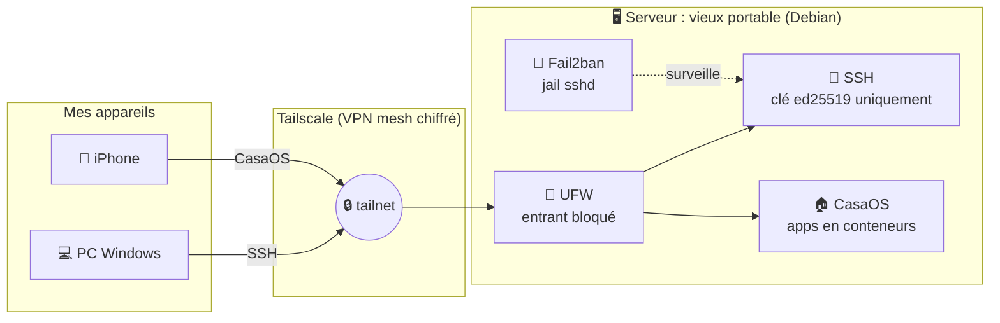

<!--
  README de profil GitHub, version "terminal / hacker"
  1. Crée un dépôt PUBLIC nommé exactement comme ton pseudo GitHub
  2. Mets ce fichier à la racine sous le nom README.md
  3. Remplace TON_PSEUDO / TON_PRENOM / liens (Ctrl+H)
-->

<div align="center">


<a href="https://github.com/TON_PSEUDO">
  
</a>

<br/>


</div>

---

## `$ neofetch`

```text
       .--.          TON_PRENOM@homelab
      |o_o |         ─────────────────────────────
      |:_/ |         OS        : BTS SIO (1re année)
     //   \ \        Role      : Développeur junior
    (|     | )       Focus     : Dev · Réseau · Cyber
   /'\_   _/`\       Homelab   : Debian + CasaOS + Tailscale
   \___)=(___/       Langages  : JavaScript · Python
                     Status    : 🟢 cherche un stage
```

---

## `$ ls ~/stack`

> Clique sur un badge pour ouvrir la techno.

**`~/stack/dev`**

<p>
  <a href="https://developer.mozilla.org/fr/docs/Web/JavaScript"></a>
  <a href="https://www.python.org/"></a>
  <a href="https://developer.mozilla.org/fr/docs/Web/HTML"></a>
  <a href="https://developer.mozilla.org/fr/docs/Web/CSS"></a>
  <a href="https://www.gnu.org/software/bash/"></a>
  <a href="https://git-scm.com/"></a>
  <a href="https://github.com/"></a>
</p>

**`~/stack/network`**

<p>
  <a href="https://www.debian.org/"></a>
  <a href="https://www.linux.org/"></a>
  <a href="https://tailscale.com/"></a>
  <a href="https://www.openssh.com/"></a>
  <a href="https://www.wireshark.org/"></a>
  <a href="https://www.netfilter.org/"></a>
</p>

**`~/stack/security`**

<p>
  <a href="https://github.com/fail2ban/fail2ban"></a>
  <a href="https://www.kali.org/"></a>
  <a href="https://tryhackme.com/"></a>
  <a href="https://owasp.org/"></a>
</p>

**`~/stack/selfhost`**

<p>
  <a href="https://casaos.zimaspace.com/"></a>
  <a href="https://www.docker.com/"></a>
</p>

> 💡 Retire les badges des outils que tu n'as pas encore utilisés (Kali, TryHackMe, Wireshark...). Mieux vaut une stack honnête qu'une stack gonflée : un recruteur peut poser des questions dessus.

---

## `$ cat ~/homelab/architecture.md`



---

## `$ tail -f ~/homelab/hardening.log`

```log
[2026-11] casaos     : installé sur Debian, interface web opérationnelle
[2026-11] tailscale  : serveur + iPhone dans le même tailnet, aucun port ouvert sur la box
[2026-11] ufw        : policy deny incoming, accès limité au LAN et à Tailscale
[2026-11] sshd       : authentification par clé ed25519 (avec passphrase)
[2026-11] sshd       : PasswordAuthentication no, PermitRootLogin no
[2026-11] fail2ban   : jail sshd actif, ban temporaire après plusieurs échecs
[next]    monitoring : à venir
[next]    backups    : à venir
```

<details>
<summary><b><code>$ man homelab</code></b> : pourquoi ces choix (cliquer pour déplier)</summary>

<br/>

| Choix | Raison |
|-------|--------|
| ♻️ Vieux portable recyclé | Zéro achat, batterie intégrée, consommation maîtrisée |
| 🌐 Tailscale plutôt que redirection de ports | Accès distant sans exposer le serveur sur Internet |
| 🔑 SSH par clé uniquement | Supprime le risque de brute force sur mot de passe |
| 🧱 UFW en deny par défaut | On n'ouvre que le strict nécessaire |
| 🚫 Fail2ban | Bannit automatiquement les IP qui insistent |

> 📸 *Captures d'écran de l'interface CasaOS à ajouter ici.*

</details>

---

## `$ ls ~/projects`

<table>
  <tr>
    <td width="50%" valign="top">

### 🏠 `homelab/`
Serveur perso sécurisé : Debian, CasaOS, Tailscale, UFW, Fail2ban, SSH durci.


[`> cd homelab`](https://github.com/TON_PSEUDO/NOM_DU_DEPOT_HOMELAB)

</td>
    <td width="50%" valign="top">

### 🚧 `projet-2/`
Décris ici ton projet en une ou deux phrases : ce qu'il fait, pourquoi.


[`> cd projet-2`](https://github.com/TON_PSEUDO/NOM_DU_DEPOT_2)

</td>
  </tr>
  <tr>
    <td width="50%" valign="top">

### 🚧 `projet-3/`
Décris ici ton projet en une ou deux phrases : ce qu'il fait, pourquoi.


[`> cd projet-3`](https://github.com/TON_PSEUDO/NOM_DU_DEPOT_3)

</td>
    <td width="50%" valign="top">

### 🌐 `portfolio/`
```text
status: 404 not found yet
eta   : bientôt 🚀
```

<!-- Quand il sera en ligne : [`> cd portfolio`](https://TON_SITE.fr) -->

</td>
  </tr>
</table>

---

## `$ ./stats.sh`

<div align="center">


<br/>


<br/>


<br/>

<!-- Serpent animé : nécessite l'Action décrite en bas du fichier -->


</div>

---

## `$ cat ~/roadmap.md`

- [x] Monter un home lab sur du matériel recyclé
- [x] Sécuriser un serveur : pare-feu, SSH par clé, anti-bruteforce
- [x] Accès distant sans ouvrir de ports (Tailscale)
- [ ] Ajouter du monitoring (ex : Uptime Kuma, Grafana)
- [ ] Mettre en place des sauvegardes automatisées
- [ ] Mettre mon portfolio en ligne
- [ ] Pratiquer la cybersécurité en CTF (TryHackMe, Root-Me)
- [ ] Décrocher un stage 🎯

---

## `$ ./contact.sh`

<div align="center">

<a href="https://www.linkedin.com/in/TON_LINKEDIN/"></a>
<a href="mailto:ton.email@exemple.fr"></a>
<!-- <a href="https://TON_SITE.fr"></a> -->

<br/><br/>

```text
$ echo "Un stage à proposer ? Écris-moi !"
Un stage à proposer ? Écris-moi !
$ _
```


</div>

<!--
=====================================================================
OPTIONNEL : serpent animé (Snake) qui mange tes contributions
=====================================================================
1. Crée le fichier .github/workflows/snake.yml dans ton dépôt de profil
2. Colle :

name: Generate Snake
on:
  schedule:
    - cron: "0 0 * * *"
  workflow_dispatch:
  push:
    branches: [ main ]
permissions:
  contents: write
jobs:
  generate:
    runs-on: ubuntu-latest
    steps:
      - uses: Platane/snk/svg-only@v3
        with:
          github_user_name: ${{ github.repository_owner }}
          outputs: |
            dist/github-snake-dark.svg?palette=github-dark
      - uses: crazy-max/ghaction-github-pages@v3.1.0
        with:
          target_branch: output
          build_dir: dist
        env:
          GITHUB_TOKEN: ${{ secrets.GITHUB_TOKEN }}

3. Onglet Actions > "Generate Snake" > Run workflow
=====================================================================
-->
